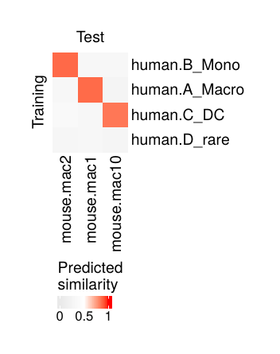
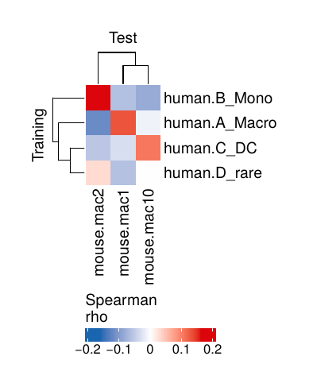
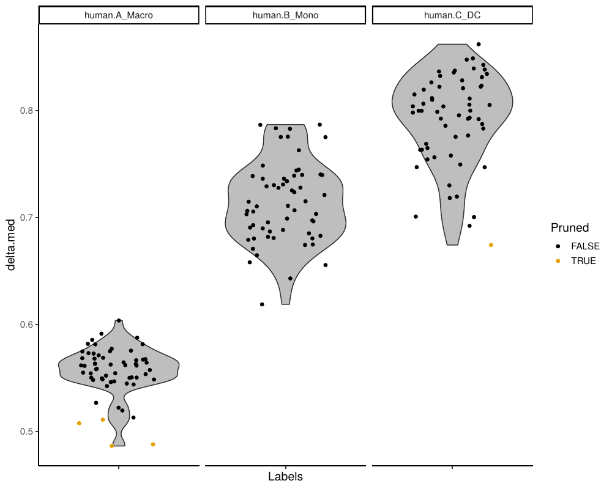
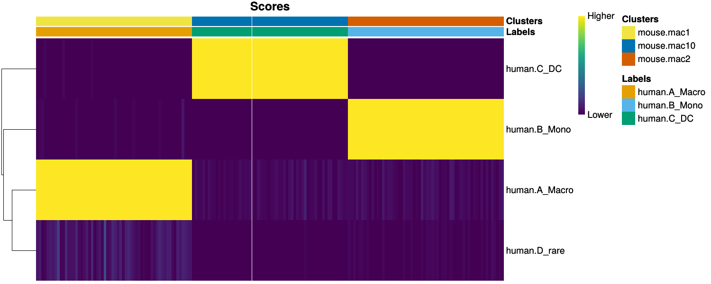

# scrna-cellstate-similarity

Quantifies the transcriptional similarity between cell states annotated in two
single-cell RNA-seq datasets, typically a human reference atlas and a mouse
model, using three complementary readouts: elastic-net logistic regression,
correlation of pseudobulk profiles, and SingleR label transfer.

## Purpose

Mouse models are routinely annotated with cell states whose correspondence to
human states is asserted rather than measured. This pipeline reproducibly
identifies the reference state that each test state most closely resembles
and provides diagnostic measures to assess confidence in that match. It supports
human-mouse comparisons in either direction and can also compare two datasets
from the same species.

The three outputs address different aspects of similarity. The logistic regression
tests whether a reference-trained classifier can recognise the test cells;
pseudobulk correlation evaluates similarity between the average expression
profiles of entire states; and SingleR classifies individual test cells,
revealing heterogeneity within a test state. Concordance across readouts is more
informative than any single one.

## Method

1. **Shared gene universe.** For cross-species comparisons, genes are mapped
   to 1:1 human-mouse orthologs with babelgene. For same-species comparisons,
   the intersection of gene names is used.
2. **Symmetric renormalisation.** Both datasets are renormalised from raw
   counts to log1p counts per 10,000 on the shared gene universe, so that the
   classifier is trained and applied on the same scale. Cells with zero counts
   on the shared universe are removed.
3. **Elastic-net logistic regression.** For each reference state, a binomial
   one-vs-rest model is fitted with glmnet on all reference cells, with an offset
   equal to the log-odds of the state's frequency and no intercept. Lambda is
   selected by cross-validation (`lambda.min`, misclassification error) using
   one fold partition shared across all models. Logits are averaged within each test state and
   transformed to the probability scale.
4. **Pseudobulk correlation.** Raw counts are summed per state and
   transformed to log1p counts per million. Highly variable genes (vst) are
   ranked independently in each dataset, and the feature space is derived from
   the gene intersection. Each gene is then z-scored across the states of its own
   dataset; genes that do not vary across states in either dataset are removed.
   Reference and test states are compared by Spearman correlation.
5. **SingleR.** Each test cell is assigned to a reference state using the
   single-cell reference, with marker detection set by `SINGLER_DE_METHOD`
   (default Wilcoxon).

## Requirements

- R (>= 4.3)
- CRAN: Seurat (>= 5), SeuratObject, Matrix, glmnet, babelgene, circlize,
  openxlsx
- Bioconductor: SingleR, scran, ComplexHeatmap

## Inputs

Two Seurat objects saved with `saveRDS()`, each with:

- raw counts in the counts layer (Seurat v5) or counts slot (Seurat v3/v4) of
  the assay named in the config (default `RNA`);
- gene symbols as row names (HGNC for human, MGI for mouse);
- a metadata column holding the cell-state label of every cell.

To try the pipeline without real data, see [Example output](#example-output).

Each object should contain only the cells to be compared. Every reference
state needs at least two cells, and states with fewer cells than `GLM_NFOLDS`
trigger a warning because their lambda selection is unreliable. Seurat v5
objects with split count layers are joined automatically.

## Configuration

Copy `config/config.example.R` to `config/config.R` and edit it.


| Parameter | Default | Used by | Description |
|---|---|---|---|
| `REF_PATH`, `TEST_PATH`, `OUT_DIR` | | all | Input objects and output folder |
| `REF_SPECIES`, `TEST_SPECIES` | human, mouse | 01 | `"human"` or `"mouse"` |
| `ASSAY` | RNA | 01 | Assay holding raw counts |
| `REF_LABEL_COL`, `TEST_LABEL_COL` | cell_state | 01 | Metadata columns with state labels |
| `REF_NAME`, `TEST_NAME` | ref, test | 01 | Prefixes added to labels in all outputs; must differ |
| `ORTHOLOG_MIN_SUPPORT` | 3 | 01 | Minimum databases supporting an ortholog pair |
| `SEED` | 1234 | 02 | Random seed (fold assignment) |
| `GLM_ALPHA` | 0.99 | 02 | Elastic-net mixing parameter |
| `GLM_NFOLDS` | 10 | 02 | Cross-validation folds |
| `GLM_THRESH`, `GLM_MAXIT` | 1e-6, 1e6 | 02 | glmnet convergence settings |
| `SINGLER_DE_METHOD` | wilcox | 02 | SingleR marker detection |
| `HVG_N` | 2000 | 02 | Top HVGs taken from each dataset for the correlation |
| `BASE_SIZE`, `CELL_MM` | 14, 8 | 03 | Font size (pt) and heatmap cell size (mm) |
| `COR_LOW`, `COR_MID`, `COR_HIGH` | #1965B0, white, #DC050C | 03 | Correlation colour scale |
| `LR_LOW`, `LR_MID`, `LR_HIGH` | #e9e9e9, white, red | 03 | Logistic regression colours at 0, 0.5, 1 |
| `NA_COL` | #e9e9e9 | 03 | Colour of masked cells |
| `CLUSTER_HM`, `CLUSTER_METHOD` | TRUE, ward.D2 | 03 | Ordering of heatmap rows and columns |

## Running

From the repository root:

```
Rscript scripts/01_prepare.R         config/config.R
Rscript scripts/02_similarity.R      config/config.R
Rscript scripts/03_figures_tables.R  config/config.R
```

The scripts must be run from the repository root; relative paths in the config
are resolved against it.

Each script always recomputes its own step, and stores the parameters it used
with its output. A downstream script stops, naming the script to rerun, if:

- an analysis parameter of an upstream step differs from the config;
- the input objects named in the config (path, size or modification time)
  differ from those used by `01`;
- `01` was rerun after `02`.

Plotting parameters can be changed freely and require rerunning `03` only.

## Outputs

All outputs are written to `OUT_DIR`.

**`rds/`**: intermediate objects (`01_prepared.rds`, `02_results.rds`) and
`01_run_id.txt`, which identifies the run of `01`.

**`figures/`**

| File | Content |
|---|---|
| `lr_similarity_heatmap.pdf` | Logistic regression similarity; rows are reference states, columns test states |
| `pseudobulk_spearman_heatmap.pdf` | Spearman correlation of z-scored pseudobulk profiles, with dendrograms when `CLUSTER_HM = TRUE` |
| `singler_score_heatmap.pdf` | SingleR scores per test cell, grouped by test state |
| `singler_delta_distribution.pdf` | SingleR delta distributions per assigned label |


**`tables/similarity_results.xlsx`**

| Sheet | Content |
|---|---|
| `metadata` | Input file names, analysis parameters as used to compute the results, ortholog counts (all pairs, 1:1 pairs, and 1:1 pairs present in both datasets as `shared_genes`), dropped cells and states |
| `LR_similarity` | Logistic regression similarity matrix as plotted (masked rows are empty) |
| `LR_convergence` | Per reference state: training cells, whether the model converged, and the number of non-zero coefficients at `lambda.min` |
| `cor_spearman` | Spearman correlation matrix, in heatmap order |
| `features_used` | Genes in the correlation feature space (with human symbols for cross-species runs) |
| `SingleR_assignments` | Number of cells per test state assigned to each reference state |
| `SingleR_pruning` | Number and proportion of pruned (low-confidence) SingleR assignments per test state |

**`session_info_01.txt`, `_02`, `_03`**: R session information for each step.

## Example output

The figures below were produced from simulated data and illustrate the format
of the outputs only; they carry no biological meaning. The simulation contains
four human states and three mouse states, with mouse `mac1`, `mac2` and `mac10`
built from the same expression programmes as human `A_Macro`, `B_Mono` and
`C_DC`, and human `D_rare` without a mouse counterpart. The figures are shown
here as PNG; the pipeline writes PDF.

To reproduce them:

1. Run `Rscript examples/make_synthetic_data.R <folder>`.
2. In the config, set `REF_PATH` to `<folder>/synthetic_ref.rds`, `TEST_PATH`
   to `<folder>/synthetic_test.rds`, `REF_NAME` to `human` and `TEST_NAME` to
   `mouse`; leave all other parameters at their defaults.
3. Run the three scripts as described in [Running](#running).

| Logistic regression similarity | Pseudobulk Spearman correlation |
|---|---|
|  |  |

| SingleR delta distribution | |
|---|---|
|  | |

SingleR score heatmap:



In this example all three readouts recover the simulated correspondences, and
`D_rare` has no high-similarity partner.

## Interpretation

- **Logistic regression similarity** ranges from 0 to 1. A value close to 1
  indicates that test cells are classified as the corresponding reference
  state, while 0.5 represents the model's baseline once the class prior has
  been removed. The reported value is obtained by applying the inverse logit
  to the mean logit across cells, rather than averaging individual cell
  probabilities.
- **Masked rows.** If the regularisation path for a reference state fails to
  converge, its model assigns a logit of zero to every cell, yielding a
  similarity of exactly 0.5. These rows are set to NA, displayed in `NA_COL`,
  left empty in the `LR_similarity` sheet, and flagged in `LR_convergence`.
- **Null models.** A model that converges but selects no genes at
  `lambda.min` (`n_nonzero_coef = 0`) likewise returns exactly 0.5 for every
  test state. These rows are not masked; instead, they indicate that the
  reference state could not be distinguished from the remaining reference
  states.
- **Correlation** values are relative: genes are z-scored within each
  dataset, so a positive value indicates that a test state and a reference
  state deviate from their respective dataset averages in the same direction.
  Absolute values are often modest; the ranking of matches and the difference
  between the top and second-best matches are more informative.
- **SingleR** shows whether a test state maps consistently to a single
  reference state or is distributed across several. High pruning proportions
  suggest assignments with low confidence.

## Limitations

- Only human and mouse are supported. Cross-species comparisons use 1:1
  orthologs only, so genes with one-to-many or many-to-one orthology are not
  considered.
- Same-species comparisons match genes by exact symbol, without alias
  resolution.
- Gene names containing `_` are altered by Seurat during HVG ranking and are
  effectively excluded from the correlation; a warning is issued.
- Correlations depend on which states are present in each dataset, because
  genes are z-scored within each dataset; adding or removing a state changes
  all values.
- With the default colours, masked logistic regression rows (`NA_COL`) and a
  similarity of 0 (`LR_LOW`) are drawn in the same grey. The `LR_convergence`
  sheet identifies masked rows.

## Citations

- Seurat: Hao Y et al. Dictionary learning for integrative, multimodal and
  scalable single-cell analysis. Nat Biotechnol 42, 293-304 (2024).
- SingleR: Aran D et al. Reference-based analysis of lung single-cell
  sequencing reveals a transitional profibrotic macrophage. Nat Immunol 20,
  163-172 (2019).
- glmnet: Friedman J, Hastie T, Tibshirani R. Regularization paths for
  generalized linear models via coordinate descent. J Stat Softw 33, 1-22
  (2010).
- babelgene: Dolgalev I. babelgene: Gene orthologs for model organisms in a
  tidy data format. R package, https://CRAN.R-project.org/package=babelgene
- scran: Lun ATL, McCarthy DJ, Marioni JC. A step-by-step workflow for
  low-level analysis of single-cell RNA-seq data with Bioconductor.
  F1000Research 5, 2122 (2016).
- ComplexHeatmap: Gu Z, Eils R, Schlesner M. Complex heatmaps reveal patterns
  and correlations in multidimensional genomic data. Bioinformatics 32,
  2847-2849 (2016).
- Logistic regression similarity: `glm_predict` and `getPopulationOffset`
  are adapted from the code accompanying Cheng S et al. A pan-cancer
  single-cell transcriptional atlas of tumor infiltrating myeloid cells.
  Cell 184, 792-809 (2021), which builds on the approach of Young MD et al.
  Single-cell transcriptomes from human kidneys reveal the cellular identity
  of renal tumors. Science 361, 594-599 (2018).

## Licence

MIT. See `LICENSE`.
